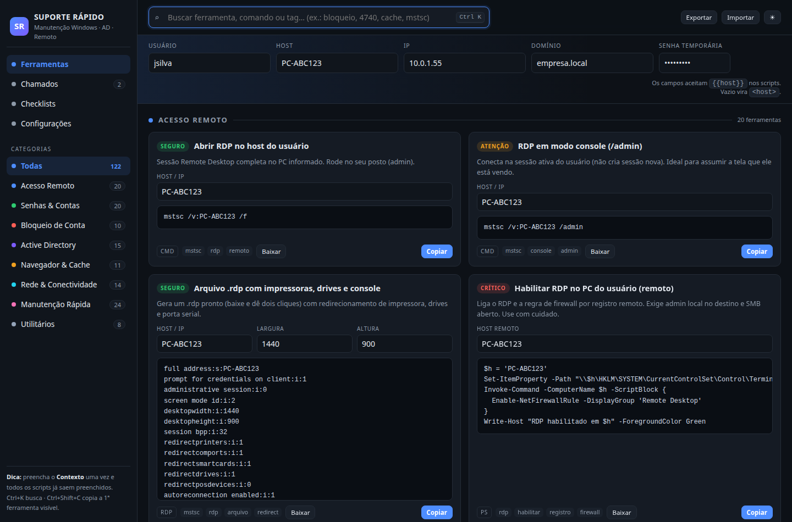
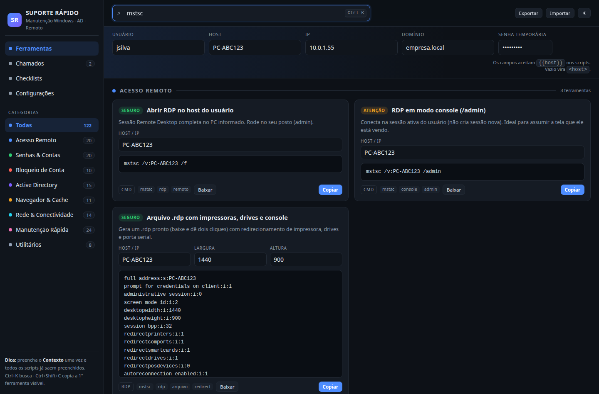
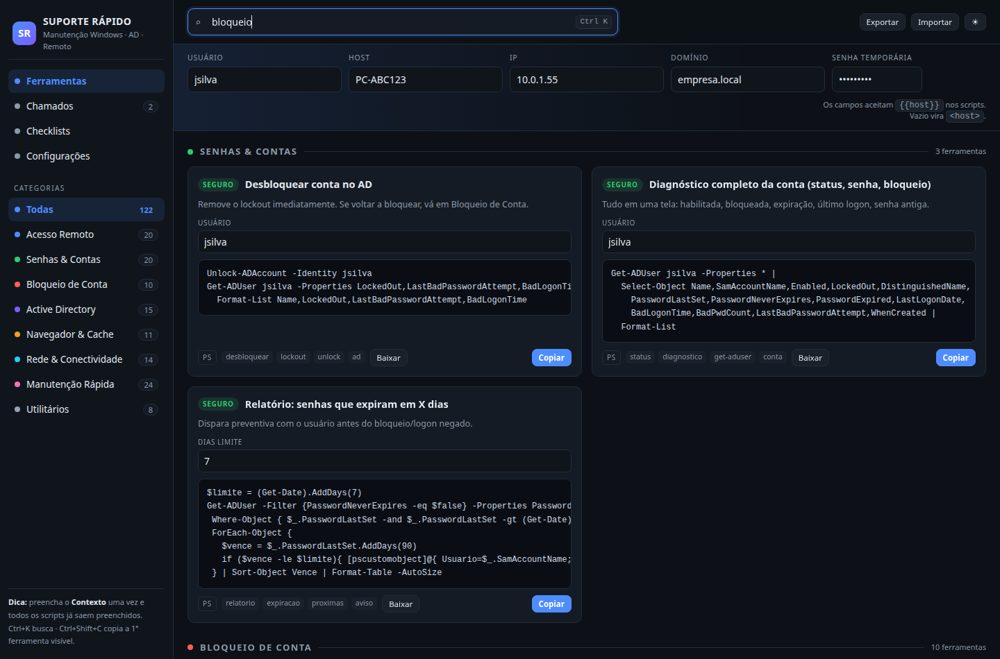
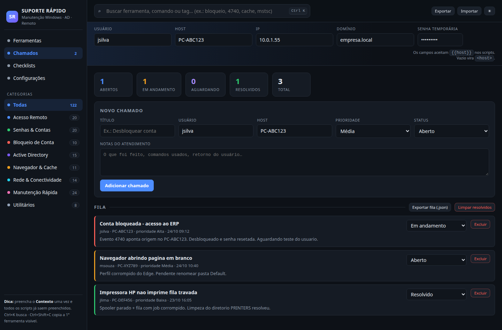
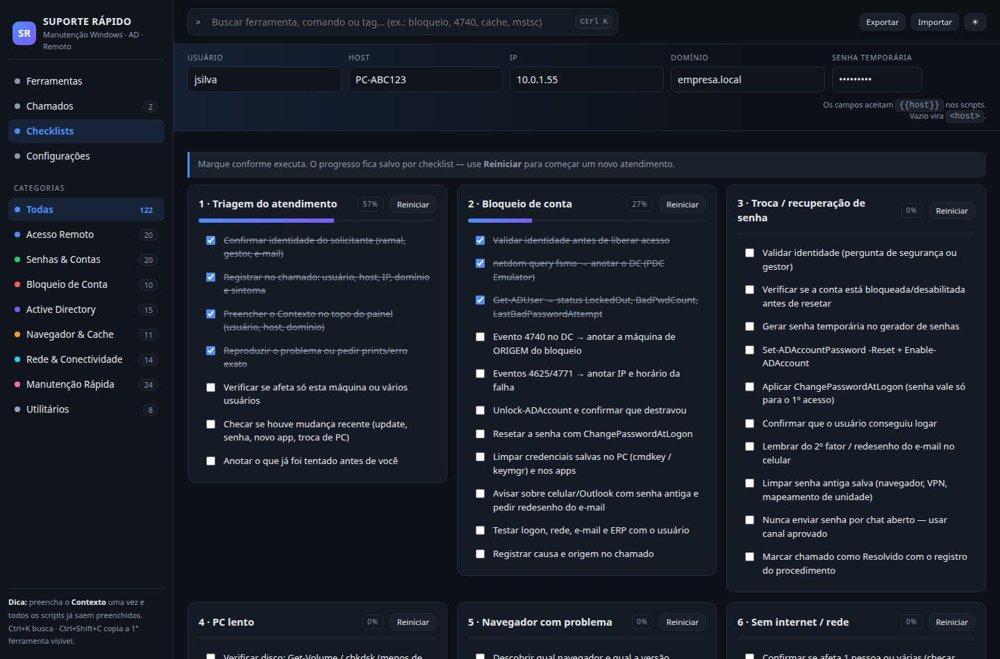
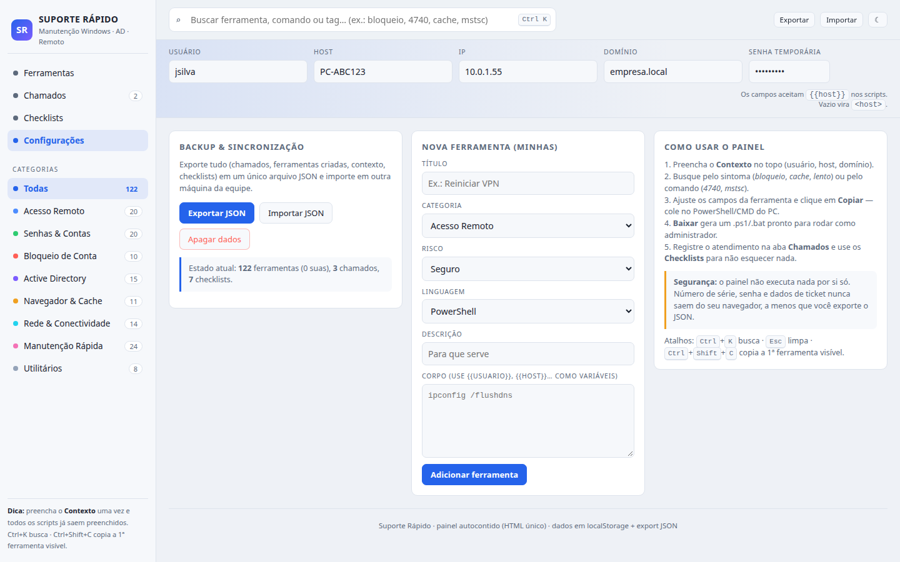
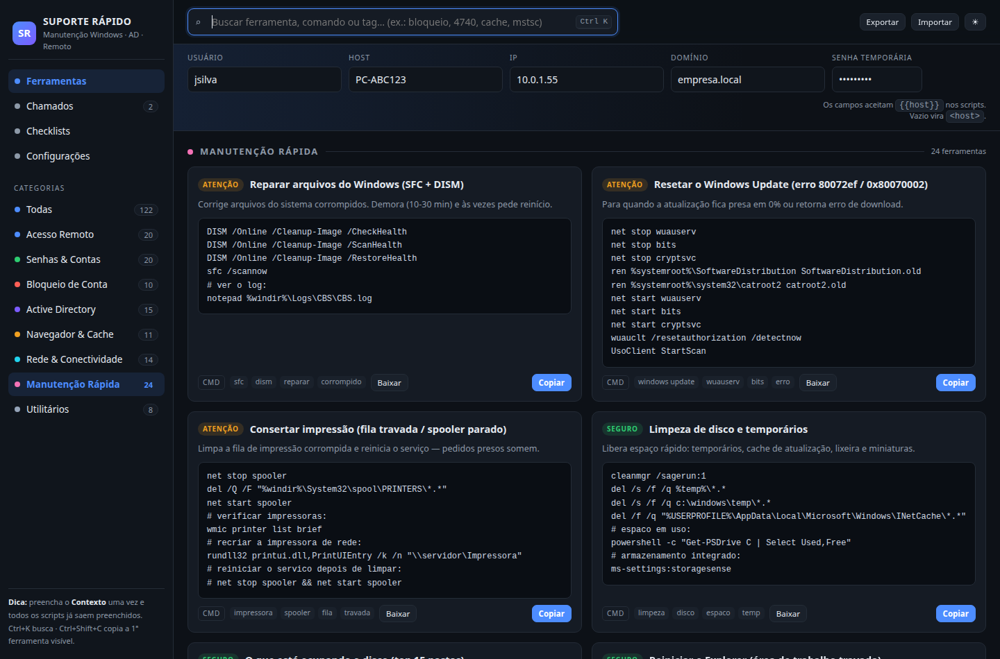
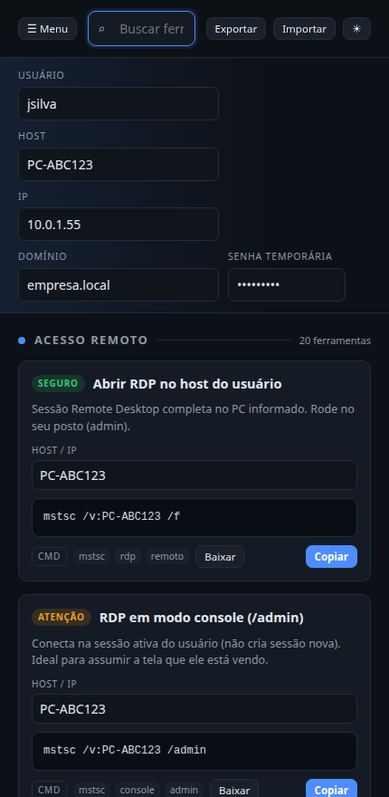

<div align="center">

# ⚡ Suporte Rápido

### Painel de manutenção, recuperação e atendimento para Windows, Active Directory e acesso remoto

**122 ferramentas · 8 categorias · 7 checklists · arquivo único HTML · offline · sem instalação**

[Manual completo](MANUAL.md) · [Telas](#-telas-do-sistema) · [Início rápido](#-início-rápido) · [Categorias](#-as-8-categorias)

</div>

---



---

## 📑 Sumário

- [O que é](#-o-que-é)
- [Telas do sistema](#-telas-do-sistema)
- [Início rápido](#-início-rápido)
- [Anatomia da tela](#-anatomia-da-tela)
- [As 8 categorias](#-as-8-categorias)
- [Contexto: scripts prontos sem digitar nada](#-contexto-scripts-prontos-sem-digitar-nada)
- [Buscar, copiar e baixar](#-buscar-copiar-e-baixar)
- [Aba Chamados](#-aba-chamados)
- [Aba Checklists](#-aba-checklists)
- [Aba Configurações](#-aba-configurações)
- [Atalhos de teclado](#-atalhos-de-teclado)
- [Selos de risco](#-selos-de-risco)
- [Dados, privacidade e sincronização da equipe](#-dados-privacidade-e-sincronização-da-equipe)
- [Compatibilidade e requisitos](#-compatibilidade-e-requisitos)
- [Estrutura do repositório](#-estrutura-do-repositório)
- [Personalização](#-personalização)
- [Segurança](#-segurança)
- [Licença](#-licença)

---

## 🧭 O que é

O **Suporte Rápido** é um painel de trabalho para o time de help desk / suporte N1-N2. Ele reúne,
em um único arquivo, tudo que se consulta ou se executa no dia a dia:

| Necessidade | O que o painel entrega |
|---|---|
| **Conectar na máquina do usuário** | `mstsc`, `.rdp` pronto com impressoras/drives, Quick Assist, Assistência Remota, PowerShell remoto, WinRM, PsExec, WMI, tarefas remotas, sessões (`quser`/`rwinsta`), share `C$` |
| **Recuperar / trocar senhas** | Reset no AD (PowerShell e interface), Entra ID / M365, conta local, desbloqueio, troca no próximo logon, lote via CSV, geradores de senha, senha de Wi-Fi e credenciais salvas |
| **Bloqueio de conta** | PDC/FSMO, evento **4740**, **4625/4771** (origem do erro), `BadPwdCount`, desbloqueio em massa, política de lockout, credencial obsoleta em celular/Outlook |
| **Problemas no AD** | `gpupdate`/`gpresult`, rejoin e canal seguro, `dcdiag`, `repadmin`, DNS SRV, perfil corrompido, SYSVOL, relógio (Kerberos), relatórios de inativos |
| **Problemas de cache no navegador** | Limpeza de cache **sem perder login**, cookies, perfil corrompido, modo limpo, políticas de GPO, atualização por `winget`, site que não abre |
| **Manutenção rápida** | SFC/DISM, reset do Windows Update, spooler de impressão, limpeza de disco, Explorer, boot lento, serviços parados, logs, ponto de restauração, backup de dados, Office/Teams, Store, CHKDSK, licenciamento |
| **Registro do atendimento** | Fila de chamados com prioridade/status/notas + checklists passo a passo + export em JSON |

> 🔒 O painel **não executa** nada sozinho. Ele monta, copia e gera os scripts — quem roda, roda
> no PowerShell/CMD da máquina alvo, com os privilégios adequados.

---

## 🖼 Telas do sistema

<table>
<tr>
<td width="50%">
<br>
<b>1. Contexto + busca</b><br>
Preencha usuário/host/domínio uma vez: a busca por <code>mstsc</code> já devolve
<code>mstsc /v:PC-ABC123 /f</code> pronto para colar.
</td>
<td width="50%">
<br>
<b>2. Busca por sintoma</b><br>
Digite <code>bloqueio</code> (ou <code>4740</code>, <code>cache</code>, <code>lento</code>) e o painel
filtra as ferramentas relevantes em todas as categorias.
</td>
</tr>
<tr>
<td width="50%">
<br>
<b>3. Chamados</b><br>
Fila de atendimento com prioridade colorida, status atualizável, notas do que foi feito e
contador de pendências na barra lateral.
</td>
<td width="50%">
<br>
<b>4. Checklists</b><br>
7 fluxos operacionais com progresso salvo por atendimento — nada esquecido no caminho.
</td>
</tr>
<tr>
<td width="50%">
<br>
<b>5. Configurações (tema claro)</b><br>
Exportar/Importar JSON, criar ferramentas próprias, estatísticas e instruções de uso.
</td>
<td width="50%">
<br>
<b>6. Categoria filtrada</b><br>
Clique numa categoria da barra lateral para ver só aquilo — 24 ferramentas de manutenção rápida.
</td>
</tr>
<tr>
<td width="50%">
<br>
<b>7. No celular</b><br>
Responsivo: menu, contexto empilhado e cartões em coluna única — dá para consultar no ramal.
</td>
<td width="50%">
&nbsp;
</td>
</tr>
</table>

---

## 🚀 Início rápido

1. **Baixe o repositório** ou apenas o `index.html`:
   ```bash
   git clone https://github.com/wilsonsampaio/windows_maintenceautomatic.git
   cd windows_maintenceautomatic
   ```
2. **Abra o `index.html`** com duplo clique (Chrome, Edge ou Firefox). Não precisa de servidor,
   não instala nada e funciona offline.
3. **Preencha o Contexto** no topo: usuário, host, IP, domínio e senha temporária.
4. **Busque** o problema pelo sintoma ou pelo comando → ajuste os campos → **Copiar** → cole no
   PowerShell/CMD da máquina alvo.
5. **Registre** o atendimento na aba *Chamados* e acompanhe os passos nos *Checklists*.

> 💡 Em máquina sem navegador atualizado, qualquer PC Windows 10/11 já resolve — o painel não
> depende de versão específica.

---

## 🗺 Anatomia da tela

```
┌─────────────┬──────────────────────────────────────────────────────────┐
│  SIDEBAR     │  BUSCA (Ctrl+K)        Exportar · Importar · ☀/☾ tema   │
│              ├──────────────────────────────────────────────────────────┤
│ Ferramentas  │  CONTEXTO: usuário | host | ip | domínio | senha         │
│ Chamados (2) ├──────────────────────────────────────────────────────────┤
│ Checklists   │  ▌ ACESSO REMOTO ·························  20 ferram.   │
│ Configurações│  ┌───────────────────────────┐ ┌──────────────────────┐  │
│              │  │ [SEGURO] Abrir RDP        │ │ [ATENÇÃO] RDP /admin │  │
│ CATEGORIAS   │  │ descrição                 │ │ descrição            │  │
│  Todas (122) │  │ HOST/IP: [PC-ABC123]      │ │ HOST/IP: [PC-ABC123] │  │
│  Remoto (20) │  │ ┌───────────────────────┐ │ │ ┌──────────────────┐ │  │
│  Senhas (20) │  │ │ mstsc /v:PC-ABC123 /f │ │ │ │ mstsc /v:... /ad │ │  │
│  ...         │  │ └───────────────────────┘ │ │ └──────────────────┘ │  │
│              │  │ CMD mstsc rdp  [Baixar]   │ │        [Copiar]      │  │
│  Dica de     │  └───────────────────────────┘ └──────────────────────┘  │
│  uso e       │                                                         │
│  atalhos     │                                                         │
└─────────────┴──────────────────────────────────────────────────────────┘
```

| Região | Função |
|---|---|
| **Barra lateral** | Navegação entre as 4 abas + contadores por categoria + dica de uso |
| **Busca** | Filtra por título, descrição, tag, corpo do comando ou categoria |
| **Contexto** | Dados do atendimento aplicados automaticamente em todos os scripts |
| **Cartão de ferramenta** | Selo de risco, título, descrição, campos editáveis, script e ações |
| **Rodapé do cartão** | Linguagem, tags, **Baixar** (gera arquivo) e **Copiar** |

---

## 📂 As 8 categorias

| # | Categoria | Qtd | Conteúdo |
|---|---|---:|---|
| 🖥 | **Acesso Remoto** | 20 | `mstsc` (console, janela, `/admin`), gerador de `.rdp`, Quick Assist, msra, `Enter-PSSession`, `Enable-PSRemoting`, PsExec, WMI, `schtasks` remoto, `quser`/`qwinsta`/`rwinsta`, robocopy para `C$`, portproxy, reboot remoto, teste de porta |
| 🔑 | **Senhas & Contas** | 20 | Reset no AD e pela ADUC, `Unlock-ADAccount`, `Enable-ADAccount`, troca no logon, "nunca expira", diagnóstico da conta, reset local, lote CSV, Entra/M365 (Graph), senha de Wi-Fi, credenciais salvas, cofre do navegador, geradores de senha (alfa e frase), `klist purge`, snapshot do usuário |
| 🚫 | **Bloqueio de Conta** | 10 | PDC/FSMO, evento **4740**, **4771/4625** com IP de origem, `BadPwdCount`, desbloqueio em massa, política de lockout, limpeza de credencial velha, fluxo de investigação (celular/Outlook), `Test-ComputerSecureChannel`, checklist de atendimento |
| 🏢 | **Active Directory** | 15 | `gpupdate`/`gpresult`, RSOP, rejoin e canal seguro, `dcdiag`, `repadmin`, DNS SRV/`nltest`, encontrar o PC do usuário, busca de objetos, membros de grupo, inativos, perfil corrompido, SYSVOL, `w32tm`, `net use`, cheat sheet de erros |
| 🌐 | **Navegador & Cache** | 11 | Limpeza por script (Chrome/Edge/Firefox), limpeza só do cache (mantém login), renomear perfil, modo limpo, extensões, políticas de GPO no navegador, refresh do Firefox, atualização por `winget`, diagnóstico de site, recuperar dados do perfil antigo |
| 🌍 | **Rede & Conectividade** | 14 | Diagnóstico completo, `flushdns`, `ping`/`tracert`/`pathping`, `nslookup`, teste de porta, reset de WinStack/IP, renovação DHCP, IP duplicado, proxy/PAC, Wi-Fi, firewall, `netstat`, VPN, acesso a share |
| 🛠 | **Manutenção Rápida** | 24 | DISM + SFC, reset do Windows Update, spooler, limpeza de disco, top de pastas, Explorer, processo travado, boot lento, inicialização, serviços parados, logs/Event Log, ponto de restauração, backup com robocopy, Office/Teams, Store, CHKDSK, icacls, energia/bateria, drivers, desinstalação, impressora, licença, modo seguro, coleta de diagnóstico |
| 🧰 | **Utilitários** | 8 | Cheat sheet de teclas, atalhos `ms-settings`, `msg` na tela do usuário, `Start-Process -Verb RunAs`, verificação de admin/UAC, ficha técnica do PC, sessão logada, contagem regressiva antes de reiniciar |

---

## 🧩 Contexto: scripts prontos sem digitar nada

Preencha os campos do topo **uma única vez** por atendimento. Todo script do painel usa
variáveis que são substituídas na hora:

| Variável | Vem de | Exemplo de saída |
|---|---|---|
| `{{usuario}}` | campo **Usuário** | `jsilva` |
| `{{host}}` | campo **Host** | `PC-ABC123` |
| `{{ip}}` | campo **IP** | `10.0.1.55` |
| `{{dominio}}` | campo **Domínio** | `empresa.local` |
| `{{senha}}` | campo **Senha temporária** | `••••••••` |
| qualquer outro | campo próprio do cartão | `{{ssid}}`, `{{porta}}`, `{{site}}`… |

- Campo **vazio** → aparece `<host>` no script: é um lembrete visual de que falta preencher.
- O **campo do cartão** tem prioridade sobre o Contexto — dá para usar o Contexto como padrão e
  ajustar um valor pontualmente.
- A senha temporária fica em `<input type="password">` (não aparece na tela), mas é copiada junto
  quando o script usa `{{senha}}`.

---

## 🔍 Buscar, copiar e baixar

**Busca** (`Ctrl+K`): varre título, descrição, tags, corpo do comando e categoria. Exemplos que
funcionam:

| Você digita | O que aparece |
|---|---|
| `4740` | evento de lockout + origem da origem |
| `mstsc` | comandos de RDP |
| `cache` | limpeza de cache (navegador e DNS) |
| `bloqueio` | desbloqueio, política, investigação |
| `lento` | boot, disco, serviços, logs |
| `spooler` | impressão |
| `reset` | Windows Update, Edge, Teams, Store, Winsock |

**Copiar** — leva o script já preenchido para a área de transferência.

**Baixar** — gera um arquivo pronto:

| Linguagem do cartão | Arquivo gerado | Como rodar |
|---|---|---|
| `PS` | `.ps1` com cabeçalho `chcp 65001` | botão direito → *Executar com o PowerShell* |
| `CMD` / `BAT` | `.bat` com `@echo off` | duplo clique (admin se necessário) |
| `RDP` | `.rdp` | duplo clique abre o mstsc já configurado |
| `URL` | botão vira **Abrir** | abre a tela (`edge://settings/…`, `ms-quick-assist:`) |
| `TXT` | `.txt` | passo a passo / cheat sheet |

---

## 🎫 Aba Chamados


- **Novo chamado**: título, usuário, host (vem do Contexto), prioridade, status e notas.
- **Estatísticas** no topo: abertos, em andamento, aguardando, resolvidos, total.
- **Fila**: barra lateral colorida por prioridade (vermelha = alta, amarela = média, verde = baixa),
  status alterável no lugar, notas visíveis e botão *Excluir*.
- **Exportar fila (.json)** → copia para outra máquina; **Limpar resolvidos** → mantém a fila leve.
- O contador de pendências aparece ao lado de *Chamados* na barra lateral.

---

## ✅ Aba Checklists


| Checklist | Passos | Para quando |
|---|---:|---|
| 1 · Triagem do atendimento | 7 | Todo chamado novo |
| 2 · Bloqueio de conta | 11 | Conta bloqueada no AD |
| 3 · Troca / recuperação de senha | 10 | Reset de senha |
| 4 · PC lento | 11 | Desempenho |
| 5 · Navegador com problema | 12 | Cache, perfil, site |
| 6 · Sem internet / rede | 11 | Conectividade |
| 7 · Novo PC / onboarding | 13 | Entrega de máquina |

O progresso fica salvo por checklist, com barra de porcentagem; **Reiniciar** zera para o próximo
atendimento.

---

## ⚙️ Aba Configurações


| Ação | O que faz |
|---|---|
| **Exportar JSON** | Baixa um `.json` com Contexto, chamados, checklists e ferramentas criadas |
| **Importar JSON** | Mescla o conteúdo do arquivo no navegador atual |
| **Apagar dados** | Remove tudo do `localStorage` (pede confirmação) |
| **Nova ferramenta** | Cria um cartão próprio (título, categoria, risco, linguagem, corpo com `{{variáveis}}`) com selo *meu* e botão *Excluir* |
| **Estado atual** | Contagem de ferramentas, chamados e checklists |

> 🔄 **Fluxo de equipe**: quem monta uma ferramenta nova → *Exportar JSON* → manda o arquivo →
> os demais *Importar JSON*. Simples assim, sem servidor.

---

## ⌨️ Atalhos de teclado

| Atalho | Ação |
|---|---|
| `Ctrl + K` | Foca na busca (e volta para a aba Ferramentas) |
| `Esc` | Limpa a busca |
| `Ctrl + Shift + C` | Copia a primeira ferramenta visível |

**Fora do painel** (Windows) — veja a ferramenta *Cheat sheet: atalhos de teclado*:
`Win+X` (menu admin), `Win+R`, `Win+E`, `Ctrl+Shift+Esc` (tarefas), `Win+L`, `Win+Shift+S` (print).

---

## 🚦 Selos de risco

Todo cartão traz um selo que indica o nível de atenção antes de colar o comando:

| Selo | Significado | Exemplos |
|---|---|---|
| 🟢 **SEGURO** | Só consulta / leitura, não altera nada | `gpupdate`, evento 4740, `ping`, ficha técnica |
| 🟡 **ATENÇÃO** | Altera estado (senha, serviço, perfil, política) | reset de senha, `net use /delete`, renomear perfil |
| 🔴 **CRÍTICO** | Pode derrubar sessão, mudar boot ou quebrar permissão | `rwinsta`, desligar remoto, `icacls`, modo seguro, rejoin |

---

## 🗄 Dados, privacidade e sincronização da equipe

- Tudo é gravado no **`localStorage` do próprio navegador** — nada sai do seu posto.
- O painel **não tem servidor**, **não envia telemetria** e **não executa comandos**.
- Senha temporária fica mascarada no campo de Contexto.
- Para levar dados para outra máquina: **Exportar JSON** → **Importar JSON**.
- Para zerar: **Apagar dados** (Configurações).
- Dica de higiene: não deixe a senha temporária no Contexto depois do atendimento.

---

## 💻 Compatibilidade e requisitos

| Item | Requisito |
|---|---|
| Navegador | Chrome, Edge, Firefox ou qualquer um atual (usa `localStorage`, `Blob`, `fetch` de arquivo) |
| Sistema | Windows 10/11, Linux ou macOS — o painel é só HTML |
| Servidor | **Nenhum** (também funciona via GitHub Pages) |
| Internet | Não obrigatória (offline); necessária só para abrir links externos |
| Executar os scripts | PowerShell/CMD **como administrador** conforme a ferramenta |
| Módulos AD | `ActiveDirectory` (RSAT) para os comandos de domínio; a maioria dos comandos locais roda sem nada |

**Publicar online** (opcional): GitHub → *Settings → Pages → Deploy from a branch* → `main`/root →
`https://wilsonsampaio.github.io/windows_maintenceautomatic/`.

---

## 📁 Estrutura do repositório

```
windows_maintenceautomatic/
├── index.html              # ⚡ o sistema inteiro (HTML + CSS + JS, ~110 KB)
├── README.md               # este arquivo
├── MANUAL.md               # 📖 manual completo passo a passo
├── .gitignore
└── docs/
    └── screenshots/        # telas usadas na documentação
        ├── 01-ferramentas.png
        ├── 02-contexto-e-busca.png
        ├── 03-busca-sintoma.png
        ├── 04-chamados.png
        ├── 05-checklists.png
        ├── 06-configuracoes.png
        ├── 07-categoria-manutencao.png
        └── 08-celular.png
```

---

## 🛠 Personalização

**Pelo painel (sem mexer no código):** aba *Configurações* → *Nova ferramenta*.
No corpo, escreva `{{qualquer_variavel}}` e o painel cria sozinho um campo editável no cartão
para cada variável que ainda não exista no Contexto. Exemplo de corpo:

```powershell
Restart-Service -Name '{{servico}}' -Force
Get-Service {{servico}} | Format-Table Name,Status
```

O cartão nasce com o campo *servico* pronto: preencha, copie ou baixe como `.ps1`.
As variáveis do Contexto (`{{usuario}}`, `{{host}}`, `{{ip}}`, `{{dominio}}`, `{{senha}}`) são
substituídas automaticamente, sem gerar campo.

**No código:** o array `TOOLS` no `index.html` é a fonte de tudo. Um item tem esta forma:

```js
{
  id:'flux-dns',            // identificador único
  cat:'rede',               // remoto | senha | bloqueio | ad | navegador | rede | manutencao | util
  risk:'safe',              // safe | warn | danger
  lang:'cmd',               // ps | cmd | rdp | url | txt
  title:'Limpar cache de DNS',
  desc:'Resolve site com IP antigo.',
  tags:['flushdns','dns'],
  inputs:[{id:'alvo', label:'Alvo', ph:'8.8.8.8', def:'8.8.8.8'}],
  body:String.raw`ipconfig /flushdns`
}
```

> Use sempre `String.raw` nos corpos — assim os caminhos `C:\Windows` não perdem a barra invertida.

---

## 🔐 Segurança

- **Valide a identidade** do solicitante antes de resetar senha, desbloquear conta ou liberar RDP.
- Revise o comando antes de colar — principalmente os selos **ATENÇÃO** e **CRÍTICO**.
- Prefira `ChangePasswordAtLogon` em vez de deixar a senha temporária fixa.
- Não envie senha por chat aberto; use o canal aprovado pela empresa.
- Exporte o JSON só quando for realmente compartilhar — ele pode conter dados de chamado.
- O painel é uma **ferramenta de apoio**: as ações em domínio/servidor seguem a política da sua TI.

---

## 📖 Manual completo

O passo a passo detalhado de cada aba, fluxos práticos de atendimento, execução de scripts,
solução de problemas do próprio painel e glossário estão em **[MANUAL.md](MANUAL.md)**.

---

## 📄 Licença

Uso interno da equipe de suporte. Se for publicar ou adaptar, mantenha a autoria do repositório.

<div align="center">
<b>Suporte Rápido</b> · painel autocontido · 122 ferramentas · zero dependências
</div>
